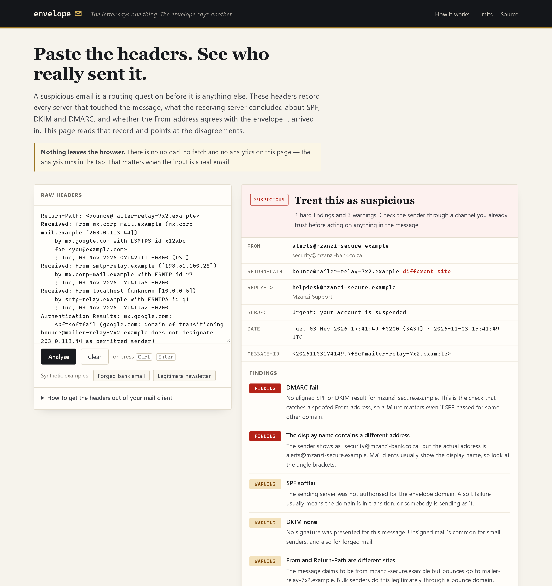
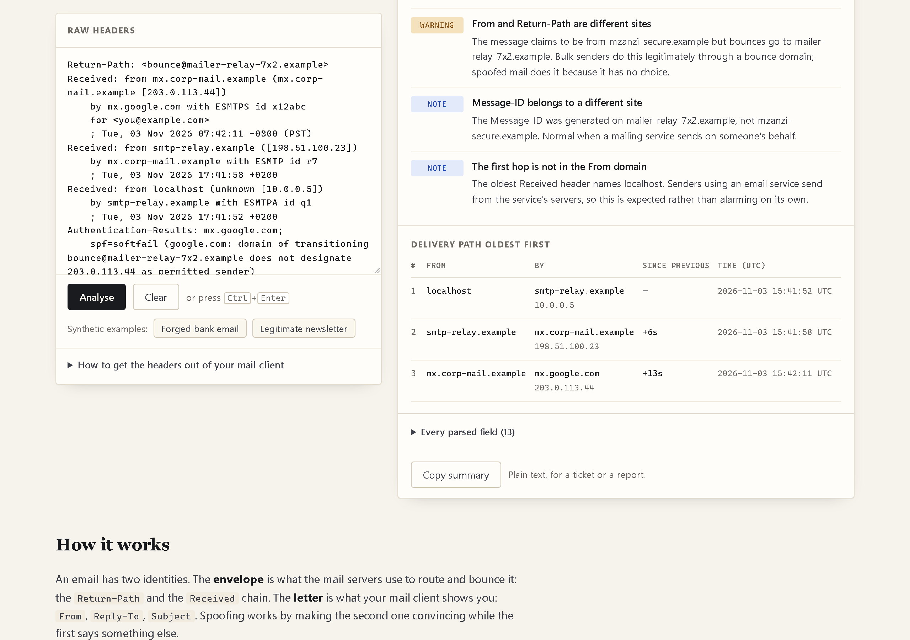
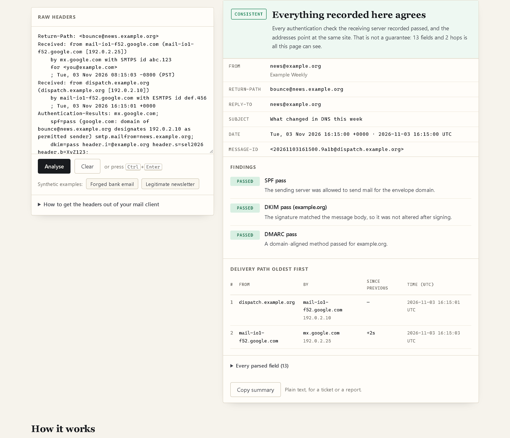
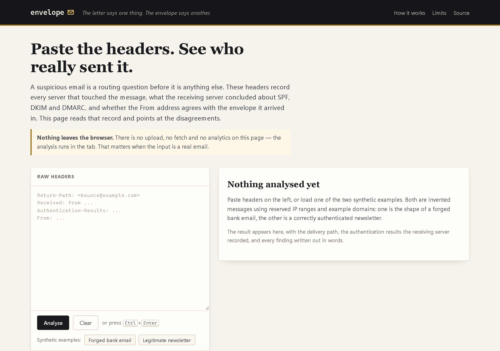
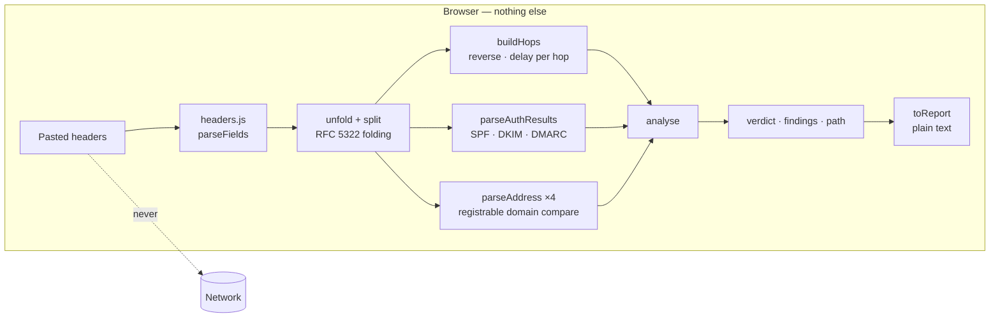

# envelope

**Paste the raw headers from a suspicious email and see the route it actually took, what the receiving server concluded about SPF, DKIM and DMARC, and where the From, Return-Path and Reply-To addresses disagree. One page, no build step, no server, no dependencies — and nothing you paste ever leaves the browser.**

<p>
  <a href="https://github.com/dominicnkutha1-netize/envelope/actions/workflows/ci.yml"></a>
  
  
  
  
  
  
</p>

**[▶ Open envelope](https://dominicnkutha1-netize.github.io/envelope/)** — the two examples on the page run without you pasting anything.

<p align="center">
  <a href="docs/screenshots/verdict.png"></a>
</p>

<sub><b>The whole point in one screen.</b> The message claims to be from a bank. The display name contains the bank's address; the actual address does not. DMARC failed, so the receiving server could not tie the From domain to anything it verified. Captured from the live page using the built-in synthetic sample — no real email, no mock-up.</sub>

<table>
  <tr>
    <td width="50%" valign="top">
      <a href="docs/screenshots/delivery-path.png"></a><br>
      <sub><b>The route, oldest first</b> — <code>Received</code> headers are written newest-first, so they are reversed and the delay between each hop is calculated. A negative delay means a clock, or the header, was edited.</sub>
    </td>
    <td width="50%" valign="top">
      <a href="docs/screenshots/clean.png"></a><br>
      <sub><b>The boring case, done properly</b> — a correctly authenticated newsletter comes out green, so the red verdict means something. A tool that flags everything is a tool nobody reads.</sub>
    </td>
  </tr>
</table>

<p align="center">
  <a href="docs/screenshots/empty.png"></a>
</p>

<sub><b>Nothing pasted yet.</b> The empty state says what the two samples are — invented messages on documentation IP ranges — so the first thing the page does is refuse to pretend.</sub>

---

## Contents

- [Why this exists](#why-this-exists)
- [Features](#features)
- [How it works](#how-it-works)
- [Tech stack](#tech-stack)
- [Quick start](#quick-start)
- [Testing](#testing)
- [Deployment](#deployment)
- [Design decisions](#design-decisions)
- [Known limitations](#known-limitations)
- [Roadmap](#roadmap)
- [License](#license)

---

## Why this exists

Somebody forwards you an email that says their account is suspended, or that a payment
details changed, and asks "is this real?". The visible part of an email — the sender name,
the logo, the reply address — is chosen by whoever sent it. Nothing in it is evidence.

The headers are the evidence. They record which servers handled the message and in what
order, and the receiving server writes down what it concluded about SPF, DKIM and DMARC
after checking them. That record is the difference between "this looks fake" and "this
came from a domain that is not the domain it claims, and the authentication failed".

Reading them by hand is tedious but not hard: the route is at the bottom of the header
block, the authentication report is one long folded line, and the interesting part is
comparing four addresses that are allowed to differ. This page does the reading so the
conversation can be about the answer.

It is also a deliberate exercise in honesty about a security tool: a passing SPF check
proves a domain sent the mail, not that the domain is trustworthy, and the page says so
everywhere it could be misunderstood.

## Features

| Area | What it does |
|---|---|
| 🧭 **Delivery path** | Reverses the `Received` chain into the order the message actually travelled, with the time between each hop and the IP each server saw |
| 🔐 **Authentication report** | Reads SPF, DKIM and DMARC out of `Authentication-Results`, with the domain each result applies to |
| ⚖️ **Verdict, not a score** | Only ever *consistent*, *mixed* or *suspicious* — each defined by the findings listed under it |
| 🎭 **Identity comparison** | `From` against `Return-Path`, `Reply-To`, `Sender`, `Message-ID` and the first hop, compared by registrable domain (`mail.example.co.za` = `example.co.za`) |
| 🪤 **Named tricks** | A display name hiding a different address, punycode or non-ASCII From domains, a `Date` older than delivery, hop clocks that run backwards |
| 🧾 **Copyable summary** | Plain-text report for a ticket, because screenshots do not paste into ticket comments |
| 🔗 **Deep links** | `?sample=suspicious` loads an example, which makes the page usable in a write-up |
| ⚡ **No build, no dependencies** | Four static files. Nothing to compile, nothing to keep patched |
| 🔒 **Nothing leaves the browser** | No upload, no `fetch`, no analytics, no cookies, no storage — CI fails the build if any of that appears in `assets/` |
| ♿ **Keyboard and screen readers** | Labelled paste box, `aria-live` result panel, genuine `<table>` markup for the route, reduced-motion support |

## How it works



The page does not look anything up. It reads what the receiving mail server already wrote
down and reports the disagreements, which is why it can work on a real email without
sending that email anywhere.

`headers.js` holds everything worth testing and none of the DOM:

| Function | Job |
|---|---|
| `splitMessage` | Header block ends at the first blank line; the body is ignored |
| `unfold` | Joins continuation lines. `Received` headers are almost always folded mid-address, so an unfolded parse loses the timestamp on every hop |
| `parseFields` | Ordered fields, duplicates kept — `Received` and `Authentication-Results` legitimately repeat |
| `parseAddress` | `"Name" <a@b>`, `<a@b>`, `a@b` and `mailto:` forms, after RFC 2047 decoding |
| `parseReceived` | `from`, `by`, `with`, `id`, `for`, the bracketed IP and the timestamp of one hop |
| `buildHops` | Reverses to delivery order and computes the delay since the previous hop, negative included |
| `parseAuthResults` | SPF, DKIM (with signing domain) and DMARC, plus the domain the receiver checked |
| `registrableDomain` | `mail.example.co.za` → `example.co.za`, using a short two-label suffix list |
| `analyse` | Produces the findings, the counts and the verdict; every finding carries the sentence that explains it |
| `toReport` | The same analysis as plain text |

## Tech stack

| Layer | Choice | Why |
|---|---|---|
| Markup | Hand-written HTML | One page; a framework would add a build step for nothing |
| Styling | Hand-written CSS, custom properties | No preprocessor, no utility framework |
| Logic | Native ES modules | `<script type="module">`, no bundler |
| Network | None | The privacy claim is architectural, not a setting |
| Tests | `node:test` + `node:assert` | Zero dependencies, runs on a bare Node install |
| CI | GitHub Actions | Tests on Node 20 and 22, plus a static-site and no-network check |
| Hosting | GitHub Pages | Static files, HTTPS, free |

## Quick start

There is no install step. Serve the folder over HTTP — `file://` will not load ES
modules — and open it:

```bash
git clone https://github.com/dominicnkutha1-netize/envelope.git
cd envelope

python -m http.server 8080
# or: npx serve . -l 8080
```

Open <http://localhost:8080>. Turn off your network after the page loads; it still works,
which is the simplest proof of the privacy claim.

To analyse a real message, get its headers first:

| Client | Where |
|---|---|
| Gmail | Message → ⋮ → **Show original** → **Copy to clipboard** |
| Outlook (web) | Message → **More actions** → **View** → **View message source** |
| Outlook (desktop) | Message → **File** → **Properties** → **Internet headers** |
| Apple Mail | **View** → **Message** → **All Headers** |

Pasting the whole message is fine: everything after the first blank line is ignored.

## Testing

```bash
node --test
```

42 tests, two files, no dependencies.

`tests/headers.test.mjs` (30) covers the parsing that is easy to get subtly wrong:
unfolding a header split mid-timestamp, duplicates and order, a body line that looks like
a header, base64 and quoted-printable encoded words, addresses with and without angle
brackets, dates with a timezone comment, a hop with no timestamp, delivery order and the
delay between hops (including a clock that runs backwards), the authentication report with
and without a DKIM signature, registrable domains for `co.za` and `co.uk`, the two samples
producing *suspicious* and *consistent* respectively, a partial paste, a missing
`Received` chain, punycode, the plain-text report, and an empty paste that must not throw.

`tests/site.test.mjs` (12) covers the failure modes of a static site and the promises on
it: every `src`/`href` in `index.html` resolving to a real file, every import resolving,
**every screenshot the README links actually being committed**, required metadata, a real
`<label>` on the paste box, no third-party scripts or fonts, no `fetch`/`XMLHttpRequest`/
`WebSocket`/`sendBeacon`/`new Image` anywhere in `assets/` (the page says nothing leaves the
browser, so CI enforces it), samples restricted to documentation IPs and reserved domains,
no leftover `console.log`/`debugger`, the CSS variables the markup relies on, and the
documented run/test commands still existing.

That last-but-two test exists because "runs entirely in your browser" is the kind of claim
that quietly stops being true. It is a cheap check, and it makes the promise testable
instead of aspirational.

## Deployment

The repository is the deployment. GitHub Pages serves `main` from the root:

1. **Settings → Pages → Source: Deploy from a branch → `main` / `/ (root)`**
2. Push to `main`; Pages rebuilds in about a minute.
3. `https://dominicnkutha1-netize.github.io/envelope/`

There is no environment variable, no secret and no server to keep alive. The same four
files work on any static host, from a USB stick to S3.

## Design decisions

**A verdict in words, not a risk score.** "7.4/10" is a number a person cannot argue with
or act on. *Suspicious*, *mixed* and *consistent* are defined by the findings listed
underneath, and every finding is a sentence about something the reader can check. Where a
pattern is commonly innocent — a different `Return-Path` for a bulk sender, a `Message-ID`
from a mailing service — the finding says so rather than inflating the count.

**No backend, because the input is a real email.** The moment a page uploads headers to a
server, using it on a genuine suspicious message becomes a privacy decision. Doing the work
in the tab removes the decision, and makes the promise on the page verifiable: turn off the
network and it still analyses. CI checks that no code path can send the paste anywhere.

**The route is shown from the bottom up.** Everything above the last `Received` header was
written by the sender and can say anything. Reversing the chain puts the only hop you can
trust at the end, and makes "the message travelled from here to here" read in the direction
a person expects.

**Authentication pass ≠ safe.** A lookalike domain can have perfect SPF, DKIM and DMARC. So
the page never says "safe"; it says what was verified, by whom, and repeats the gap in the
limits section. A security tool that overstates its own coverage is worse than no tool.

**`headers.js` is DOM-free on purpose.** Every edge case worth testing lives there, so the
suite runs in Node with no browser, no network and no mocking library.

## Known limitations

Honest list, because a tool that claims to see everything has not been thought about hard
enough.

- **It does not re-check anything.** No DNS lookups, no signature verification. It reports
  what the receiving server recorded. If that server never checked, or lied, this page
  cannot tell.
- **Headers can be forged.** Everything above your provider's own `Received` line is
  written by the sender. A determined forger can make an inner chain look plausible; the
  bottom hop is the only one with authority.
- **A pass is not a character reference.** SPF, DKIM and DMARC prove which domain sent the
  message, not that the domain is honest.
- **Domain comparison is approximate.** It uses a short list of two-label suffixes
  (`co.za`, `co.uk`, `com.au`, …), not the full Public Suffix List, so an unusual registry
  structure can compare the wrong two labels.
- **No IP reputation, geolocation or blocklist check**, because that would require a
  network request.
- **Attachments, links and the body are not analysed** at all. This is a header tool.
- **One message is not a campaign.** A suspicious header is a reason to verify the sender
  through another channel, not a conclusion about an organisation.

## Roadmap

1. ✅ **Parse, rebuild the route, explain the findings** — 42 tests, no dependencies.
2. ✅ **Screenshots in the README** — real captures, with a test that stops a broken image
   from ever reaching the repository page.
3. ✅ **A no-network guarantee CI can enforce** — a test that fails the build if any
   `assets/` file gains a network call.
4. **Side-by-side comparison** — paste two messages and diff their routes and auth results,
   which is how a campaign is recognised.
5. **Received-chain confidence marker** — show explicitly which hop is the first one added
   by a provider, instead of only explaining it in prose.
6. **Optional local DNS check** — a clearly separated mode that queries a public DoH
   resolver for the From domain's SPF and DMARC records, off by default and never automatic.
7. **Saved-case format** — export an anonymised case as JSON so a support team can keep a
   record without keeping the email.

## License

MIT — see [LICENSE](LICENSE). © 2026 Dominic Nkutha
